# 32-Bit SimpleRisc CPU — Logisim → Verilog → FPGA → SkyWater 130 nm

A single-cycle, five-stage 32-bit processor for the SimpleRisc ISA (21 instructions). I built it three ways:

1. **Logisim:** the full datapath and control unit, drawn gate by gate
2. **Verilog:** ported and run on a Digilent FPGA, with the result shown over HDMI
3. **Silicon layout:** taken through the open-source LibreLane flow to a **DRC-, LVS- and antenna-clean** layout in the SkyWater 130 nm process

All three run the same test program, which computes **10! = 3,628,800**.

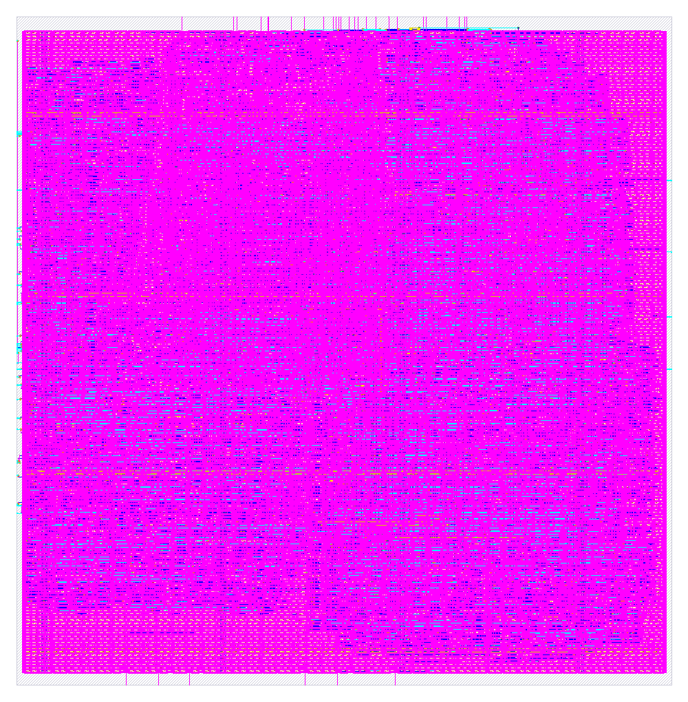

---

## 1. Logisim design

The top level wires the five stages (IF, OF, EX, MA, RW) and the control unit together. Each block is its own subcircuit.

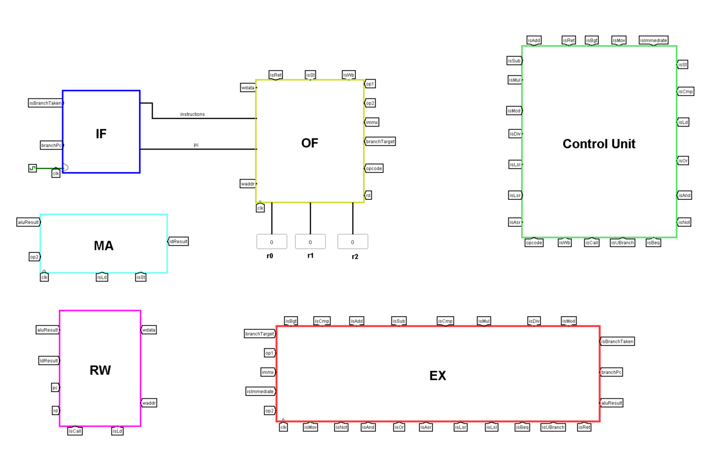

### Inside the blocks

**Operand Fetch (OF):** splits the 32-bit instruction into its fields (opcode, rd, rs1, rs2), reads two registers from the register file, and builds the sign-extended immediate and the branch target.

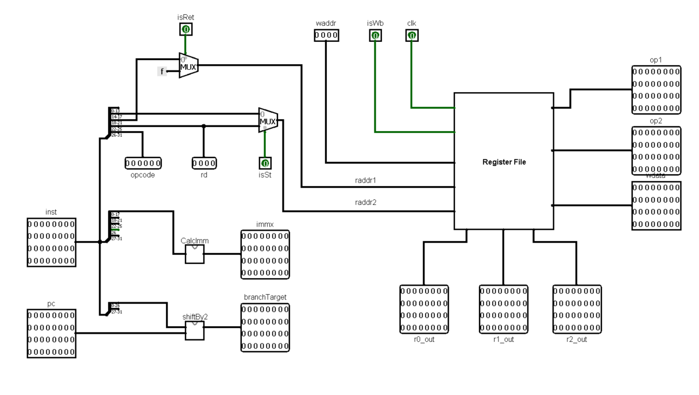

**Execute (EX):** the ALU does the math, a mux picks register or immediate for operand B, and the stored compare flags (E, GT) decide whether a branch is taken.

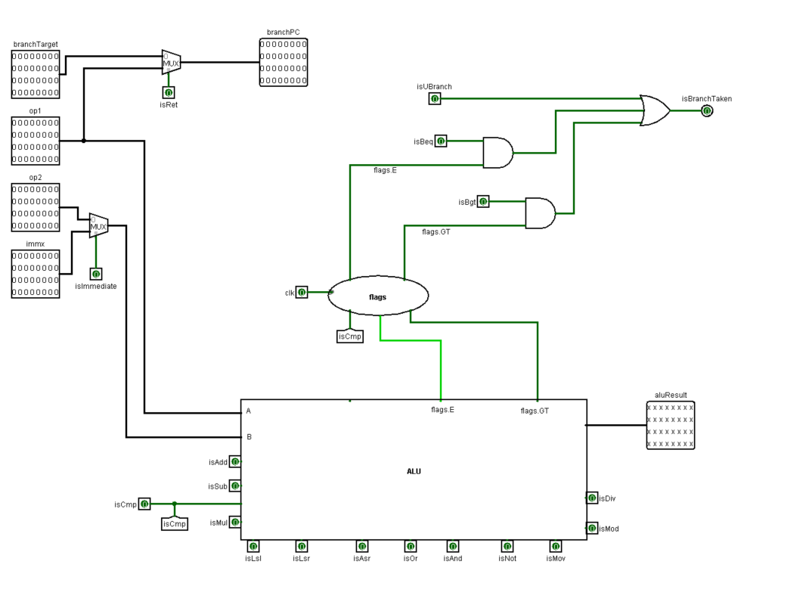

<details>
<summary><b>Click to see the rest of the subcircuits</b> (IF, register file, control unit, ALU, flags, MA, RW)</summary>

**Instruction Fetch (IF)**
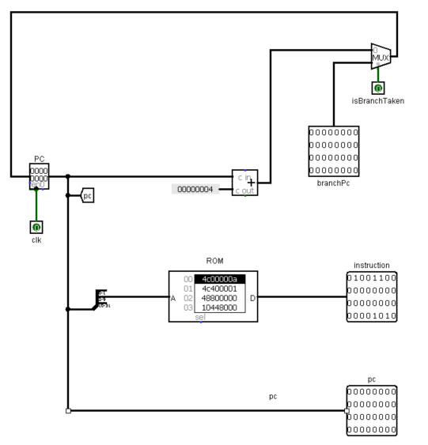

**Register file:** 16 registers, two 16-to-1 muxes for the two read ports
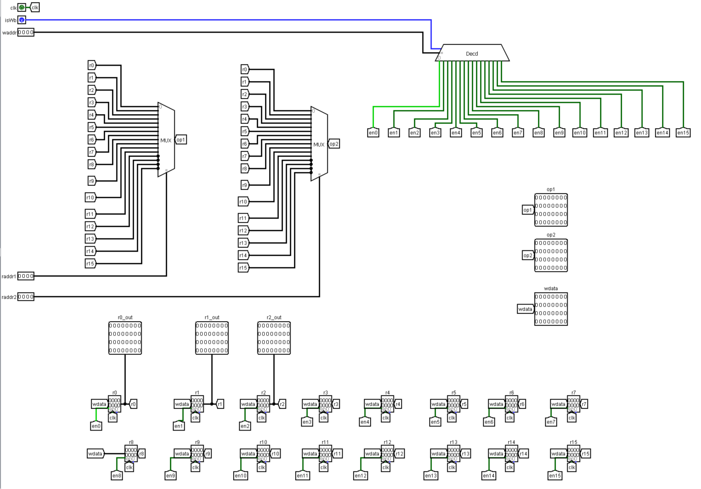

**Control unit:** turns the opcode into the control signals
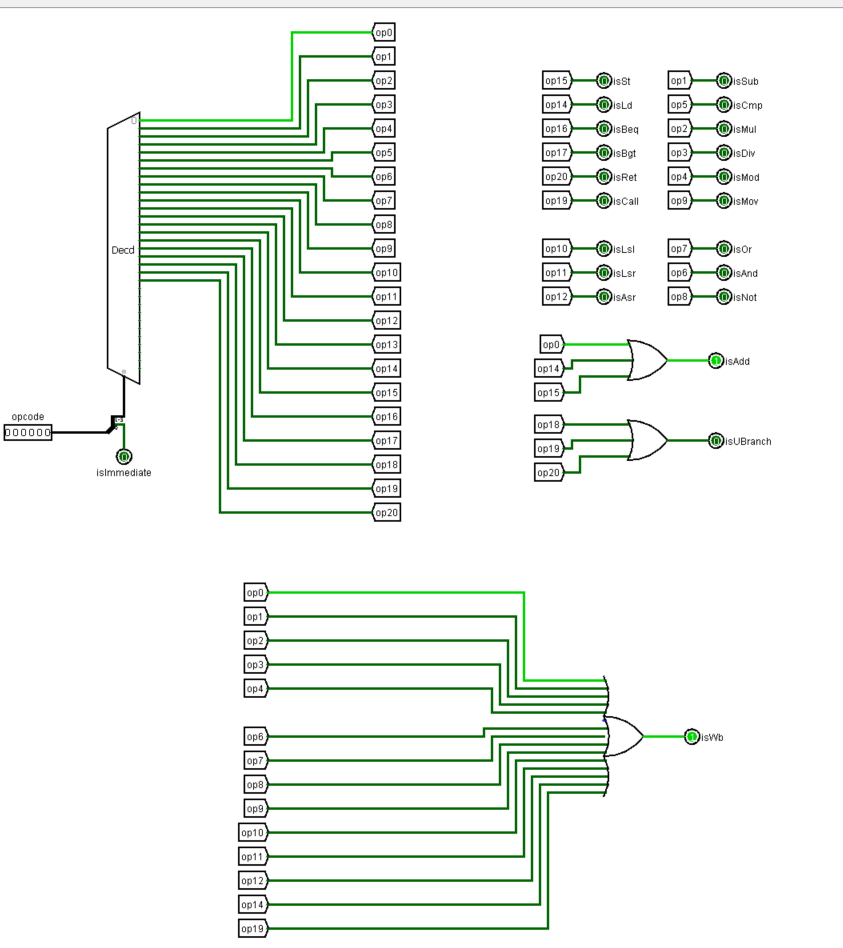

**ALU**
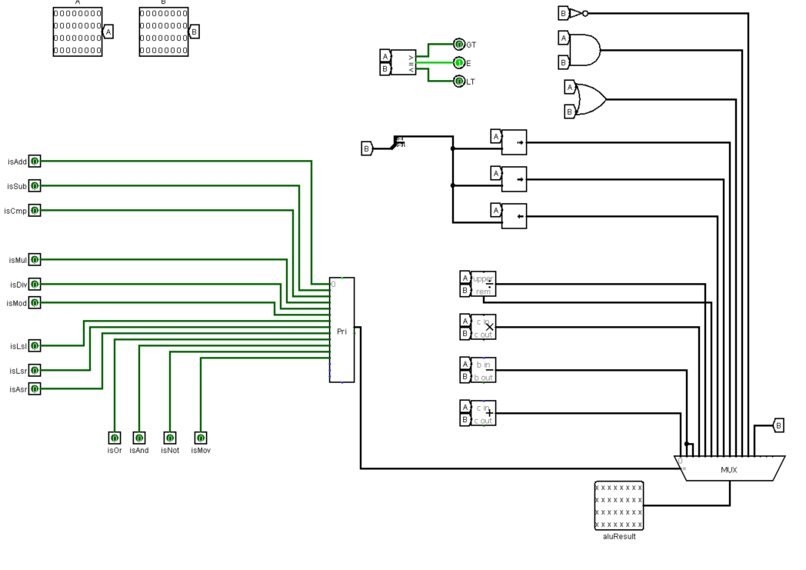

**Flags:** two flip-flops that hold E and GT from `cmp` until the branch uses them
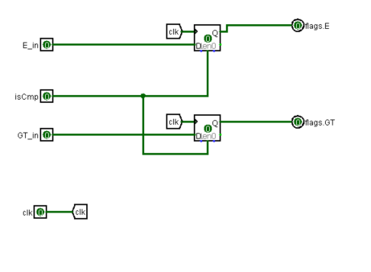

**Memory Access (MA)**
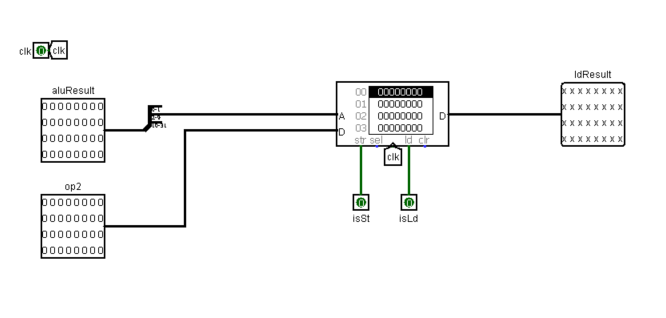

**Register Writeback (RW)**
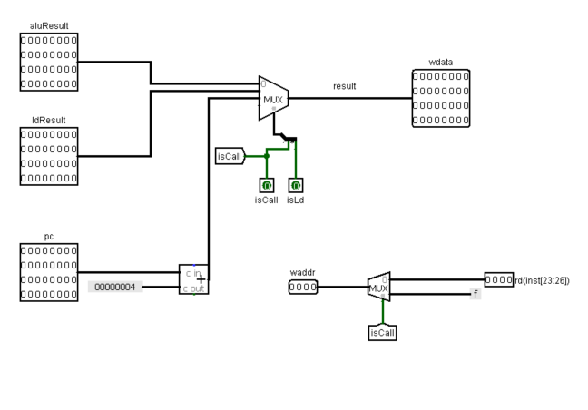

</details>

### Result

After running the factorial program, register `r1` holds 10! = 3,628,800:

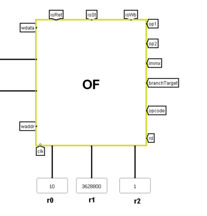

## 2. Verilog on FPGA

Each Logisim block became a Verilog module ([`rtl/`](rtl/)). On a Digilent Zybo Z7 FPGA board, pressing a button runs the program, and `r1` is drawn over HDMI as a 32-bit binary number (white = 1):

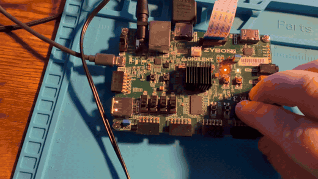

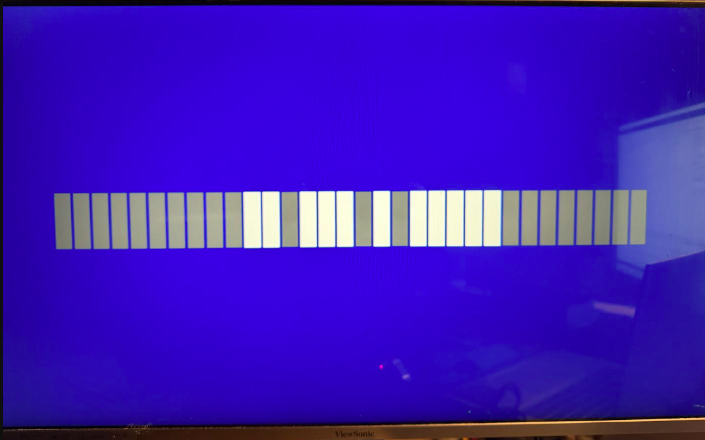

`0000 0000 0011 0111 0101 1111 0000 0000` = `0x00375F00` = **3,628,800**

## 3. ASIC layout (LibreLane, sky130A, sky130_fd_sc_hd)

| Metric | Value |
|---|---|
| Clock constraint | 200 ns (5 MHz) |
| Worst setup slack | +135 ns (all corners) |
| Worst hold slack | +0.17 ns |
| Standard cells | ~16.8k (logic, excluding fill/tap) |
| Die size | 563 × 573 µm |
| Power (typical) | ~24 mW |
| Magic DRC / KLayout DRC | 0 / 0 |
| LVS | Pass |
| Antenna | Pass |

Full numbers are in [`asic/results/metrics.json`](asic/results/metrics.json) and the sign-off summary in [`asic/results/manufacturability.rpt`](asic/results/manufacturability.rpt). The final layout is [`asic/results/cpu.gds.gz`](asic/results/cpu.gds.gz) (gzipped, open with KLayout after `gunzip`).

The large setup slack means the design would close at a much faster clock. Tightening the constraint is the next step.

**ASIC note:** the hardware divider (`div`, `mod`) was removed from the ALU for the silicon version. A 32-bit combinational divider dominated area and the critical path.

---

## Architecture

Every instruction passes through all five stages in one clock cycle:

| Stage | File | Job |
|---|---|---|
| IF — Instruction Fetch | `if_stage.v` | PC register, loadable instruction memory |
| OF — Operand Fetch | `of_stage.v`, `regFile.v`, `immgen.v`, `branchTarget.v` | Decode fields, read registers, build immediate and branch target |
| EX — Execute | `ex_stage.v`, `alu.v`, `flag.v` | ALU operations, compare flags, branch decision |
| MA — Memory Access | `ma_stage.v` | Data RAM for `ld` / `st` |
| RW — Register Writeback | `rw_stage.v` | Write ALU result, loaded value or return address |
| Control | `control_unit.v` | Decodes the opcode into control signals |

Top level: [`rtl/cpu.v`](rtl/cpu.v). The program memory can be loaded through `prog_we` / `prog_addr` / `prog_data`, so the same chip can run different programs.

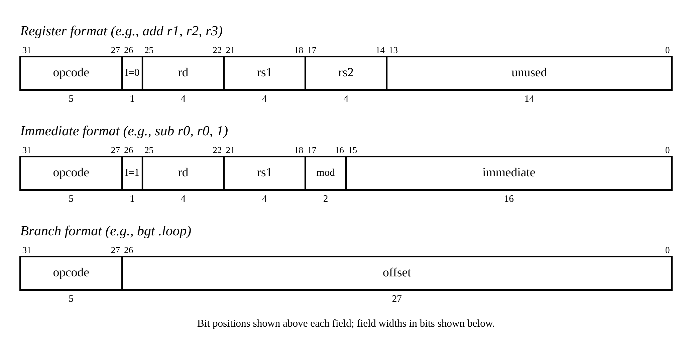

## Test program

[`tb/tb_cpu.v`](tb/tb_cpu.v) loads this program, runs it, and checks the registers, RAM and final PC:

```
mov r0, 10        ; n
mov r1, 1         ; result
mov r2, r0        ; counter
loop: mul r1, r1, r2
      sub r2, r2, 1
      cmp r2, 1
      bgt loop
st  r1, 5[r2]     ; store the answer
b   0             ; halt
```

## How to run

```bash
# Simulation (Icarus Verilog)
iverilog -o sim tb/tb_cpu.v rtl/*.v && vvp sim

# Layout (inside the IIC-OSIC-TOOLS container)
cd asic
librelane config.yaml
```

## Repository structure

```
rtl/    Verilog source (12 modules)
tb/     factorial testbench
asic/   LibreLane config + sign-off results and final GDS
docs/   pictures, IEEE-style report, slides
```

## Next steps

- Pipeline the five stages so each works on a different instruction
- Tighten the clock constraint toward the real critical path

## Author

Chad Lucas, B.S. Electrical Engineering, University of North Dakota
